# IREE RISC-V 64 (`riscv64` RVV) CI/CD Engineering & Handover Documentation

This document explains **what our RISC-V 64 Vector (`riscv64` RVV) CI/CD pipeline is trying to achieve**, **which script files run at every stage (with visual flow graphs)**, and **the exact copy-paste commands** (both modular script commands and raw underlying CLI commands) so the CI/CD team can wire up **Pull Request (PR)**, **Nightly Release**, and **Stable Release** pipelines in Jenkins, GitLab CI, GitHub Actions, or Buildkite without any guesswork.

---

## 1. Executive Summary: What Are We Trying to Do?

We maintain a fork of the [IREE (Intermediate Representation Execution Environment) compiler and runtime](https://github.com/iree-org/iree) targeting **64-bit RISC-V processors with the RISC-V Vector Extension (`riscv64` RVV 1.0)**.

Because standard CI servers run on `x86_64` Linux machines while our deployment target is `riscv64` with vector instructions (`+v`, `+zvl256b` / `+zvl512b`), our CI/CD pipeline must solve four problems automatically:

1. **Two-Stage Cross-Compilation ([IREE RISC-V Build Flow](https://iree.dev/building-from-source/riscv/))**:
   - **Host Build (`x86_64`)**: Compile the IREE compiler (`iree-compile`) and ONNX importer (`iree-import-onnx`) to run on the fast `x86_64` CI host while emitting `riscv64` RVV machine code.
   - **Target Cross-Build (`riscv64`)**: Cross-compile the lightweight IREE runtime (`iree-run-module`, `iree-benchmark-module`, and RVV microkernel test binaries) for `riscv64-unknown-linux-gnu` using [`build_tools/cmake/linux_riscv64.cmake`](https://github.com/iree-org/iree/blob/main/build_tools/cmake/linux_riscv64.cmake).
2. **Three-Tier Compiler & Runtime Verification (Lit → RVV `ukernel` → E2E Matmul)**:
   - Verify that MLIR compiler passes generate valid RISC-V vector instructions (`lit` tests), that hand-tuned RISC-V 64 C/assembly microkernels ([IREE CPU Microkernels](https://iree.dev/community/blog/2024-01-22-exploring-cpu-microkernels-on-a-matmul-example/#overview-of-the-compilation-and-linking-flow)) compute exact tile math (`ukernel` tests), and that the compiler-to-runtime tile contract (`e2e_matmul`) executes on `qemu-riscv64` (with RVV 1.0 enabled) or a physical RISC-V board.
3. **Zero-Config ONNX Model + External Weights Auto-Discovery (`stable` vs. `nightly`)**:
   - Whenever an engineer drops a new `.onnx` model and its external weight files (`.onnx.data`, `.weights`, `.bin`, `.pb`) into `tests/onnx_models/stable/<model_name>/` or `tests/onnx_models/nightly/<model_name>/`, the pipeline automatically discovers the model and weights, classifies its release tier (`stable` or `nightly`), and runs it without anyone editing CI pipeline definitions.
4. **End-to-End Numerical Accuracy Verification (ONNX Runtime Golden `.npy` vs. IREE RVV `.npy`)**:
   - To prove that IREE's RISC-V RVV compilation did not degrade model accuracy, every discovered ONNX model is fed identical deterministic NumPy input tensors (`input_0.npy`) through **both** **ONNX Runtime** (golden reference producing `ort_output_0.npy`) and **[IREE's ONNX-to-RVV path](https://iree.dev/guides/ml-frameworks/onnx/)** (or our custom pipeline script, producing `iree_output_0.npy`). The pipeline compares both NumPy arrays via `np.allclose(atol, rtol)` and reports `max_abs_diff`, `mean_abs_diff`, `RMSE`, and `cosine_similarity`.

---

## 2. Visual Flow Graphs: Which Scripts Run at Each CI/CD Stage?

### Flow Graph A: Master CI/CD Stage Pipeline (PR vs. Nightly vs. Stable Release)

```mermaid
flowchart TD
    Trigger["CI/CD Trigger Event"] --> ModeSelect{"Which Pipeline Stage?"}

    ModeSelect -->|"Pull Request (Fast Gate)"| PR["ci_entrypoint.sh --stage pr"]
    ModeSelect -->|"Nightly Schedule (Cron)"| Nightly["ci_entrypoint.sh --stage nightly"]
    ModeSelect -->|"Git Tag v*.*.* / Release"| Stable["ci_entrypoint.sh --stage stable --release-version vX.Y.Z"]

    subgraph Stage1 ["STAGE 1: Build Host Compiler & Cross-Compile RISC-V 64 RVV Runtime"]
        M01["Script: ci/riscv_rvv/modules/01_build_iree_rvv.sh\nConfig: ci/riscv_rvv/config.env"]
        M01_Host["1A. Host Build (build-host/)\nProduces: iree-compile, iree-import-onnx"]
        M01_Target["1B. Target Cross-Build (build-riscv64-rvv/)\nToolchain: build_tools/cmake/linux_riscv64.cmake\nProduces: riscv64 iree-run-module & test binaries"]
        M01 --> M01_Host --> M01_Target
    end

    PR --> M01
    Nightly --> M01
    Stable --> M01

    subgraph Stage2 ["STAGE 2: IREE Internal CTest Verification Pyramid"]
        M02["Script: ci/riscv_rvv/modules/02_run_iree_core_tests.sh --stage <pr|nightly|stable>"]
        L1["Layer 2A: Compiler Lit Tests (build-host)\nChecks MLIR -> RISC-V RVV vector lowering"]
        L2["Layer 2B: RVV Microkernel Tests (build-riscv64-rvv)\nctest -R ukernel (mmt4d, pack, unpack on QEMU RVV)"]
        L3["Layer 2C: Core Runtime / HAL / VM Tests\nctest -R 'iree/base|iree/hal|iree/vm' (PR) or Full CTest (Nightly/Stable)"]
        L4["Layer 2D: E2E Data-Tiled Matmul & Check Suite\nctest -L driver=local-task -R 'check_llvm-cpu|e2e_matmul'"]
        M02 --> L1 --> L2 --> L3 --> L4
    end

    M01_Target --> M02

    subgraph Stage3 ["STAGE 3: ONNX Model + Weights Auto-Discovery & Tier Filtering"]
        M03_Disc["Script: ci/riscv_rvv/discover_and_run_onnx.py\nScans: tests/onnx_models/stable/** and tests/onnx_models/nightly/**"]
        TierFilter{"Filter by Stage Tier"}
        M03_Disc --> TierFilter
        TierFilter -->|"--tier pr"| PR_Models["Runs models in stable/ (where run_on_pr=true)"]
        TierFilter -->|"--tier nightly"| Nightly_Models["Runs ALL models in stable/ AND nightly/"]
        TierFilter -->|"--tier stable"| Stable_Models["Runs models in stable/ (Strict fail-fast release gate)"]
    end

    L4 --> M03_Disc

    subgraph Stage4 ["STAGE 4: Per-Model ONNX Runtime vs. IREE RVV NumPy (.npy) Verification"]
        M03_Prep["Script: ci/riscv_rvv/modules/03_ort_vs_iree_numpy.py prepare\n1. Generates seeded inputs/input_0.npy\n2. Runs ONNX Runtime -> ort_outputs/ort_output_0.npy"]
        M04_Exec["Script: ci/riscv_rvv/modules/04_run_single_onnx_model.sh\nCalls USER_ACTUAL_SCRIPT or iree-import-onnx -> iree-compile -> qemu-riscv64 iree-run-module\nFeeds input_0.npy -> Saves iree_outputs/iree_output_0.npy"]
        M03_Cmp["Script: ci/riscv_rvv/modules/03_ort_vs_iree_numpy.py compare\nCompares ort_output_0.npy vs. iree_output_0.npy via np.allclose(atol, rtol)\nWrites comparison_report.json, comparison_summary.md, junit_onnx.xml"]
        M03_Prep --> M04_Exec --> M03_Cmp
    end

    PR_Models --> M03_Prep
    Nightly_Models --> M03_Prep
    Stable_Models --> M03_Prep

    subgraph Stage5 ["STAGE 5: Release Packaging (Nightly & Stable Only)"]
        Pkg["Packages host-bin/ + riscv64-bin/ into\niree-<version>.tar.gz + .sha256 checksum"]
    end

    M03_Cmp -->|"Nightly or Stable"| Pkg
```



---

### Flow Graph B: Step-by-Step Script Execution & Artifact Dataflow for Each ONNX Model

When `discover_and_run_onnx.py` processes a discovered model folder (for example, `tests/onnx_models/stable/mobilenet_v2_rvv/`), the following files and scripts execute in sequence:

```text
[tests/onnx_models/<tier>/<model_name>/]
  ├── model.onnx
  ├── model.onnx.data (or .weights / .bin — auto-detected)
  └── meta.json (optional shape / tolerance / RVV overrides)
         │
         ▼
┌────────────────────────────────────────────────────────────────────────────┐
│ STEP 1: ci/riscv_rvv/discover_and_run_onnx.py                              │
│  • Auto-discovers model.onnx + companion weight files                      │
│  • Identifies tier ("stable" or "nightly") from folder path or meta.json   │
└────────────────────────────────────────────────────────────────────────────┘
         │
         ▼
┌────────────────────────────────────────────────────────────────────────────┐
│ STEP 2: ci/riscv_rvv/modules/03_ort_vs_iree_numpy.py prepare               │
│  • Inspects ONNX graph input names, shapes, and dtypes via onnxruntime     │
│  • Writes deterministic seeded NumPy tensors:                              │
│      -> build-ci-artifacts/onnx_<tier>/<tier>/<model>/inputs/input_0.npy   │
│  • Executes ONNX Runtime (CPUExecutionProvider) on model.onnx + weights    │
│  • Writes golden reference NumPy output tensors:                           │
│      -> .../ort_outputs/ort_output_0.npy                                   │
└────────────────────────────────────────────────────────────────────────────┘
         │
         ▼
┌────────────────────────────────────────────────────────────────────────────┐
│ STEP 3: ci/riscv_rvv/modules/04_run_single_onnx_model.sh                   │
│  • Receives ONNX_MODEL_PATH, ONNX_WEIGHTS_PATHS, ONNX_INPUT_NPY_FILES,     │
│    and IREE_OUTPUT_NPY_FILES via environment variables                     │
│  • IF USER_ACTUAL_SCRIPT is set in config.env:                             │
│      -> Executes your custom pipeline script with the exact .npy paths     │
│  • ELSE (Built-in Default IREE RISC-V 64 RVV Flow):                        │
│      3a. iree-import-onnx model.onnx -o <model>.mlir                       │
│      3b. iree-compile <model>.mlir --iree-llvmcpu-target-triple=riscv64... │
│          --iree-llvmcpu-target-cpu-features=+m,+a,+f,+d,+v,+zvl256b        │
│          --iree-opt-data-tiling --iree-llvmcpu-enable-ukernels=all         │
│          -o <model>_riscv64_rvv.vmfb                                       │
│      3c. qemu-riscv64 -cpu rv64,v=true,vlen=256,vext_spec=v1.0             │
│          iree-run-module --module=<model>_riscv64_rvv.vmfb                 │
│          --input=@.../inputs/input_0.npy                                   │
│          --output=@.../iree_outputs/iree_output_0.npy                      │
└────────────────────────────────────────────────────────────────────────────┘
         │
         ▼
┌────────────────────────────────────────────────────────────────────────────┐
│ STEP 4: ci/riscv_rvv/modules/03_ort_vs_iree_numpy.py compare               │
│  • Loads ort_output_0.npy and iree_output_0.npy in NumPy                   │
│  • Verifies shapes & dtypes match                                          │
│  • Computes max_abs_diff, mean_abs_diff, max_rel_diff, RMSE, cosine_sim    │
│  • Asserts np.allclose(ort_arr, iree_arr, rtol=rtol, atol=atol)            │
│  • Outputs:                                                                │
│      -> comparison_report.json (per-model metrics)                         │
│      -> comparison_summary.md  (Markdown table for CI summary page)        │
│      -> junit_onnx_<tier>.xml  (JUnit XML test report for CI dashboard)    │
└────────────────────────────────────────────────────────────────────────────┘
```

---

## 3. Detailed Explanation of Every Stage: What Is Each Step Trying to Do?

### Stage 1: Two-Step Host + Target Cross-Compilation (`01_build_iree_rvv.sh`)
- **What it is trying to do**: IREE separates compilation (heavy MLIR/LLVM optimization passes) from execution (a lightweight C runtime). We build `iree-compile` and `iree-import-onnx` natively for the `x86_64` CI host so model compilation is fast, and then cross-compile only the IREE runtime and test binaries (`iree-run-module`, `iree-benchmark-module`, `ukernel` tests) for `riscv64-unknown-linux-gnu` using [`build_tools/cmake/linux_riscv64.cmake`](https://github.com/iree-org/iree/blob/main/build_tools/cmake/linux_riscv64.cmake).
- **Why `RelWithDebInfo` vs. `Release`**: PR and Nightly runs use `RelWithDebInfo` with `-DIREE_ENABLE_ASSERTIONS=ON` so any compiler assertion or stack trace is immediately visible on failure. Stable releases use `Release` for maximum runtime performance.

### Stage 2: IREE Internal CTest Verification Pyramid (`02_run_iree_core_tests.sh`)
This script runs four distinct layers of internal IREE tests so failures are isolated to the exact subsystem:

1. **Layer 2A — Compiler Lit Tests (`ctest --test-dir build-host -R "Codegen/LLVMCPU|riscv"`)**:
   - **What it is trying to do**: Runs MLIR `FileCheck` tests on the host compiler to verify that high-level tensor operations lower into expected RISC-V vector (`rvv`) instructions and select the right tile sizes before running anything on an emulator.
2. **Layer 2B — RISC-V 64 RVV Microkernel (`ukernel`) Unit Tests (`ctest --test-dir build-riscv64-rvv -R "ukernel"`)**:
   - **What it is trying to do**: Executes [`mmt4d_test`, `pack_test`, `unpack_test`, and `query_tile_sizes_test`](https://iree.dev/community/blog/2024-01-22-exploring-cpu-microkernels-on-a-matmul-example/#overview-of-the-compilation-and-linking-flow) under `qemu-riscv64` with RVV enabled.
   - **Why it is critical & what it covers**: In IREE, data-tiled matrix multiplications (`linalg.mmt4d`) dispatch to hand-written RISC-V 64 C/assembly microkernels in [`runtime/src/iree/builtins/ukernel/arch/riscv_64/`](https://github.com/iree-org/iree/issues/24576) (`mmt4d_riscv_64_v.c`, `mmt4d_riscv_64_zvfh.c`). These tests validate vector register arithmetic, accumulation flags, and odd-dimension padding across `f32`, `f16` (`+zvfh`), and `i8->i32` in under 30 seconds.
   - **What it does NOT cover (why Layers 2D & Stage 4 are also required)**: Standalone `ukernel` tests only cover `mmt4d`/`pack`/`unpack` and set `ALLOW_GENERIC_FALLBACK` in the test harness ([IREE Issue #24576](https://github.com/iree-org/iree/issues/24576)). They do not verify that the compiler's tile chooser (`enumerateMatmulTileRiscv64`) agrees with the runtime tile table (`mmt4d_riscv_64_tiles.inl`), nor do they test convolutions, softmax, normalization, or full-model weight loading.
3. **Layer 2C — Core Runtime, HAL & VM Tests (`ctest --test-dir build-riscv64-rvv -R "iree/base|iree/hal|iree/vm"`)**:
   - **What it is trying to do**: Verifies that the RISC-V 64 Linux multi-threaded task scheduler (`local-task`), ELF executable loader, memory allocators, and VM bytecode interpreter work properly on `riscv64`.
4. **Layer 2D — End-to-End Data-Tiled Matmul & Check Smoke Tests (`ctest --test-dir build-riscv64-rvv -L "driver=local-task" -R "check_llvm-cpu|e2e_matmul"`)**:
   - **What it is trying to do**: Compiles end-to-end `.mlir` matmul workloads with `--iree-opt-data-tiling --iree-llvmcpu-enable-ukernels=all` on the host and executes the resulting `.vmfb` modules on `qemu-riscv64`, proving the compiler-to-runtime RVV microkernel contract is unbroken.

### Stage 3 & Stage 4: Auto-Discovered ONNX Models & ONNX Runtime vs. IREE NumPy Comparison
- **What it is trying to do**: Validates real-world neural networks (`.onnx` + external weights) end to end.
- **How `stable` vs. `nightly` tiering works**:
  - **PR Stage (`--tier pr`)**: Runs only models classified as `stable` (with `run_on_pr: true`, the default for `tests/onnx_models/stable/**`) so PR feedback stays fast while protecting production models from regressions.
  - **Nightly Stage (`--tier nightly`)**: Runs **both** `stable` and `nightly` (`tests/onnx_models/nightly/**`) models overnight to test heavy models, new operators, and wider vector lengths (`+zvl512b`).
  - **Stable Release Stage (`--tier stable`)**: Runs all `stable` models as a strict release gate (`fail-fast`) before packaging the official release tarball.

---

## 4. Copy-Paste Command Reference for the CI/CD Team

The CI/CD team can integrate this pipeline in **three ways** depending on their pipeline design:
- **Option 1**: Single-command master entrypoint per trigger (simplest).
- **Option 2**: Modular stage-by-stage script commands (for multi-stage CI graphs).
- **Option 3**: Raw underlying CLI commands (if the CI/CD team prefers to write raw commands directly in their runner config without wrapper scripts).

### Option 1: Single-Command Master Entrypoint (Recommended)

```bash
# 1. Run on Every Pull Request (PR):
./ci/riscv_rvv/ci_entrypoint.sh --stage pr

# 2. Run on Nightly Schedule (Cron):
./ci/riscv_rvv/ci_entrypoint.sh --stage nightly

# 3. Run on Stable Release Tag (e.g., v1.0.0):
./ci/riscv_rvv/ci_entrypoint.sh --stage stable --release-version v1.0.0
```

### Option 2: Modular Stage-by-Stage Script Commands

If the CI/CD team splits **Build**, **Core CTest**, **ONNX Discovery**, and **ONNX Execution + NumPy Comparison** into separate pipeline stages or parallel workers:

```bash
# --- STAGE 1: Build Host Compiler & Cross-Compile RISC-V 64 RVV Runtime ---
# Use RelWithDebInfo for PR/Nightly, Release for Stable Release
./ci/riscv_rvv/modules/01_build_iree_rvv.sh --build-type RelWithDebInfo

# --- STAGE 2: Run IREE Core CTest Verification Pyramid (Lit + RVV ukernel + HAL + E2E Matmul) ---
# Pass --stage pr, --stage nightly, or --stage stable
./ci/riscv_rvv/modules/02_run_iree_core_tests.sh --stage pr

# --- STAGE 3A (Optional): Emit Dynamic JSON Matrix of Auto-Discovered ONNX Models for Parallel CI Workers ---
python3 ci/riscv_rvv/discover_and_run_onnx.py \
  --models-root tests/onnx_models \
  --tier pr \
  --emit-matrix

# --- STAGE 3B: Run All Auto-Discovered ONNX Models for the Stage (with ORT vs. IREE NumPy Comparison) ---
# To run a single model on a parallel worker, append: --model-name <MODEL_NAME>
python3 ci/riscv_rvv/discover_and_run_onnx.py \
  --models-root tests/onnx_models \
  --tier pr \
  --iree-host-bin "$(realpath build-host/install/bin)" \
  --iree-riscv-bin "$(realpath build-riscv64-rvv/tools)" \
  --pipeline-script ./ci/riscv_rvv/modules/04_run_single_onnx_model.sh \
  --work-dir build-ci-artifacts/onnx_pr \
  --junit-xml build-ci-artifacts/onnx_pr/junit_onnx_pr.xml \
  --run
```

### Option 3: Raw Underlying CLI Commands (If Writing Commands Directly Without Wrapper Scripts)

If the CI/CD team wants to know or run the exact underlying CMake, CTest, IREE, QEMU, and Python commands directly:

#### 1. Raw Build Commands (Host Compiler + `riscv64` Cross-Compiled Runtime)
```bash
# 1A. Configure & build host compiler (iree-compile, iree-import-onnx)
cmake -G Ninja -B build-host . \
  -DCMAKE_C_COMPILER=clang \
  -DCMAKE_CXX_COMPILER=clang++ \
  -DCMAKE_BUILD_TYPE=RelWithDebInfo \
  -DCMAKE_INSTALL_PREFIX=build-host/install \
  -DIREE_ENABLE_ASSERTIONS=ON \
  -DIREE_ENABLE_LLD=ON \
  -DIREE_BUILD_COMPILER=ON \
  -DIREE_BUILD_TESTS=ON \
  -DIREE_BUILD_SAMPLES=OFF \
  -DIREE_TARGET_BACKEND_LLVM_CPU=ON \
  -DIREE_BUILD_PYTHON_BINDINGS=ON

cmake --build build-host --target install iree-test-deps

# 1B. Cross-compile IREE runtime & test binaries for riscv64
cmake -G Ninja -B build-riscv64-rvv . \
  -DCMAKE_TOOLCHAIN_FILE="./build_tools/cmake/linux_riscv64.cmake" \
  -DIREE_HOST_BIN_DIR="$(realpath build-host/install/bin)" \
  -DRISCV_TOOLCHAIN_ROOT="/opt/riscv" \
  -DCMAKE_BUILD_TYPE=RelWithDebInfo \
  -DIREE_BUILD_COMPILER=OFF \
  -DIREE_BUILD_TESTS=ON \
  -DIREE_BUILD_SAMPLES=ON \
  -DIREE_ENABLE_CPUINFO=ON

cmake --build build-riscv64-rvv
cmake --build build-riscv64-rvv --target iree-test-deps
```

#### 2. Raw Core CTest Commands (PR vs. Nightly vs. Stable)
```bash
# 2A. Compiler Lit Tests (RISC-V & LLVMCPU RVV Codegen) — Run on PR, Nightly, Stable
ctest --test-dir build-host \
  -R "compiler/src/iree/compiler/Codegen/LLVMCPU|riscv" \
  --output-on-failure -j "$(nproc)" \
  --output-junit build-ci-artifacts/junit_host_lit_riscv.xml

# 2B. RISC-V 64 RVV Microkernel Tests (mmt4d, pack, unpack) — Run on PR, Nightly, Stable
ctest --test-dir build-riscv64-rvv \
  -R "ukernel" \
  --output-on-failure -j "$(nproc)" \
  --output-junit build-ci-artifacts/junit_riscv_rvv_ukernel.xml

# 2C. Core Runtime / HAL / VM Tests — Run on PR (use full ctest without -R on Nightly & Stable)
ctest --test-dir build-riscv64-rvv \
  -R "iree/base|iree/hal|iree/vm" \
  --output-on-failure -j "$(nproc)" \
  --output-junit build-ci-artifacts/junit_riscv_runtime_core.xml

# 2D. End-to-End Data-Tiled Matmul & Check Smoke Tests — Run on PR, Nightly, Stable
ctest --test-dir build-riscv64-rvv \
  -L "driver=local-task" \
  -R "check_llvm-cpu|e2e_matmul" \
  --output-on-failure -j "$(nproc)" \
  --output-junit build-ci-artifacts/junit_riscv_e2e_matmul.xml
```

#### 3. Raw Single-Model ONNX Runtime vs. IREE RISC-V 64 RVV NumPy Verification Commands
```bash
# 3A. Generate deterministic input_0.npy and run ONNX Runtime to save golden ort_output_0.npy
python3 ci/riscv_rvv/modules/03_ort_vs_iree_numpy.py prepare \
  --onnx tests/onnx_models/stable/my_model/model.onnx \
  --inputs-dir /tmp/my_model_run/inputs \
  --ort-outputs-dir /tmp/my_model_run/ort_outputs \
  --seed 42

# 3B. Import ONNX (+ external weights in same directory) to MLIR
./build-host/install/bin/iree-import-onnx \
  tests/onnx_models/stable/my_model/model.onnx \
  --opset-version 17 \
  -o /tmp/my_model_run/model.mlir

# 3C. Compile MLIR to RISC-V 64 RVV Executable (.vmfb) with RVV 1.0 & Microkernels
./build-host/install/bin/iree-compile \
  /tmp/my_model_run/model.mlir \
  --iree-hal-target-device=local \
  --iree-hal-local-target-device-backends=llvm-cpu \
  --iree-llvmcpu-target-triple=riscv64-unknown-linux-gnu \
  --iree-llvmcpu-target-abi=lp64d \
  --iree-llvmcpu-target-cpu-features="+m,+a,+f,+d,+v,+zvl256b" \
  --riscv-v-fixed-length-vector-lmul-max=8 \
  --iree-opt-data-tiling \
  --iree-llvmcpu-enable-ukernels=all \
  -o /tmp/my_model_run/model_riscv64_rvv.vmfb

# 3D. Execute on QEMU (RVV 1.0, VLEN=256) feeding input_0.npy and saving iree_output_0.npy
mkdir -p /tmp/my_model_run/iree_outputs
qemu-riscv64 -cpu rv64,v=true,vlen=256,vext_spec=v1.0 \
  -L /opt/riscv/sysroot \
  ./build-riscv64-rvv/tools/iree-run-module \
  --device=local-task \
  --module=/tmp/my_model_run/model_riscv64_rvv.vmfb \
  --function=main_graph \
  --input=@/tmp/my_model_run/inputs/input_0.npy \
  --output=@/tmp/my_model_run/iree_outputs/iree_output_0.npy

# 3E. Compare ONNX Runtime golden ort_output_0.npy vs. IREE RVV iree_output_0.npy
python3 ci/riscv_rvv/modules/03_ort_vs_iree_numpy.py compare \
  --ort-outputs /tmp/my_model_run/ort_outputs/ort_output_0.npy \
  --iree-outputs /tmp/my_model_run/iree_outputs/iree_output_0.npy \
  --atol 1e-3 --rtol 1e-3 \
  --report-json /tmp/my_model_run/comparison_report.json
```

---

## 5. Summary Matrix: PR vs. Nightly vs. Stable Release Pipeline Policies

| Pipeline Policy | Pull Request (`--stage pr`) | Nightly Release (`--stage nightly`) | Stable Release (`--stage stable`) |
| :--- | :--- | :--- | :--- |
| **Trigger Condition** | Every PR targeting `main` / `release/*` | Daily schedule (e.g., `0 20 * * *` UTC) | Git tag push (`v*.*.*`) or manual release trigger |
| **CMake Build Type** | `RelWithDebInfo` (`IREE_ENABLE_ASSERTIONS=ON`) | `RelWithDebInfo` (`IREE_ENABLE_ASSERTIONS=ON`) | `Release` (fully optimized) |
| **Host Lit Tests** | RISC-V & LLVMCPU subset (`-R "LLVMCPU\|riscv"`) | Full host Lit test suite | RISC-V & LLVMCPU subset |
| **RISC-V 64 RVV `ukernel` Tests** | Mandatory (`ctest -R ukernel`) | Mandatory (`ctest -R ukernel`) | Mandatory (`ctest -R ukernel`) |
| **RISC-V 64 Runtime / HAL / E2E Tests** | Core HAL/VM + `check_llvm-cpu` + `e2e_matmul` | Full cross-compiled CTest suite | Full cross-compiled CTest suite |
| **Auto-Discovered ONNX Models Executed** | `stable` tier models (`run_on_pr: true`) | Both `stable` AND `nightly` tier models | `stable` tier models (strict release gate) |
| **ONNX Runtime vs. IREE NumPy Check** | Mandatory (`np.allclose` per output tensor) | Mandatory (`np.allclose` + full drift report) | Mandatory (`fail-fast: true`, blocks release on mismatch) |
| **Output Artifacts for CI Dashboard** | JUnit XML + `comparison_summary.md` | JUnit XML + `comparison_summary.md` + `iree-nightly-riscv64-rvv-YYYYMMDD.tar.gz` | JUnit XML + `comparison_summary.md` + `iree-vX.Y.Z.tar.gz` + `.sha256` |