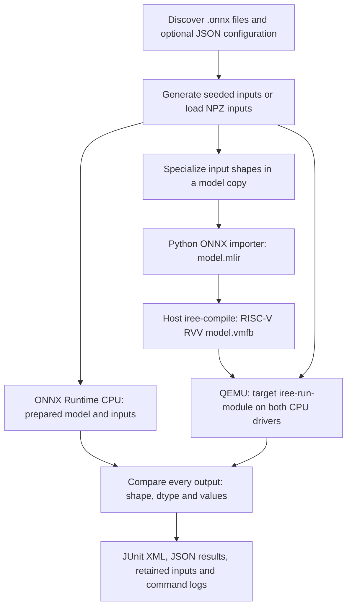

# ONNX reference comparison on RISC-V

Both RISC-V workflows discover models recursively under `tests/models/onnx/`
and compare ONNX Runtime CPU outputs against IREE outputs under RISC-V QEMU.
The stage runs in both `smoke` and `standard` profiles. Add a static model case
folder and commit it; no workflow edit or per-model registration is needed.



## One common pipeline for every model directory

No case-specific `prepare.py` is needed. Put a model folder below
`tests/models/onnx/`; discovery and preparation happen automatically:

```text
my_model/
  model.onnx
  model.json          # optional tolerances, run_on, VLEN, or explicit inputs
  input.npy           # one fixed input array
  weights.data        # optional external weights referenced by model.onnx
```

Alternatively, replace `input.npy` with `generate_input.py`. The script receives
`--output <absolute-file.npz> --model-dir <case-directory> --seed <integer>` and
must write an NPZ whose keys match the model's graph input names. It may load
CSV, NPY, or other project fixtures from the case directory. `input.py` is also
accepted for compatibility. Static ONNX shapes are required by default.

### Automatic input selection

An explicit `inputs`, `input_files`, or `input_script` setting takes precedence.
Without one, the common helper detects exactly one of:

| File | Behavior |
| --- | --- |
| `generate_input.py` or `input.py` | Run once to produce named input arrays |
| `inputs.npz` | Load arrays by graph input name |
| `input.npy` | Map the single array to the model's sole non-initializer input |

Multiple automatically detected sources fail with an ambiguity error; select
one explicitly in the manifest. Without any source, the existing deterministic
synthetic-input fallback remains available for fixed numeric/bool inputs.
Generated float values use seed 0 in [-1, 1); integers/bools use 0 and 1. Supply
realistic inputs when these values are unsuitable for the model.

For a different filename or nested data path:

```json
{"inputs": "data/my_input.npy"}
```

A single NPY file is accepted only for a model with one runtime input. For
multiple input arrays, use an explicit name-to-file mapping:

```json
{
  "input_files": {
    "x": "data/x.npy",
    "attention_mask": "data/mask.npy"
  }
}
```

Names, shapes and dtypes must match the model exactly; the helper does not
silently cast or reshape arrays. Pickled arrays are not accepted. Input arrays
are distinct from initializer weights: external `.data`/`.bin` files are loaded
through the relative references in ONNX metadata, not supplied as runtime inputs.

### Prepare one directory locally

```sh
python build_tools/riscv/prepare_onnx.py \
  --model-dir tests/models/onnx/relu --output-dir build-prepared/relu
```

The directory must contain exactly one `.onnx` file. For another layout, use
`--model /absolute/path/to/file.onnx` instead. Prepared files are written outside
the source case directory:

```text
build-prepared/relu/
  model.onnx       # resolved weights and normalized exported function main
  inputs.npz       # exact named arrays shared by both backends
  model.json       # points to the saved inputs, preserves test settings
```

### Prepare and compare one directory

```sh
python build_tools/riscv/onnx_compare.py \
  --model-dir tests/models/onnx/relu \
  --output-dir build-onnx-relu \
  --compiler /path/to/host/iree-compile \
  --runner /path/to/riscv/iree-run-module \
  --qemu /path/to/qemu-riscv64 \
  --sysroot /path/to/riscv/sysroot
```

`--model-dir` and `--models-dir` are aliases: pass one case directory or a root
collection. The runner discovers files recursively, selects the configured suite,
invokes common preparation, runs ONNX Runtime on the host, imports/compiles for
IREE, executes under QEMU on both CPU drivers, and compares all output tensors.
To diagnose with a native IREE runtime, use `--native` instead of QEMU/sysroot;
this is not RISC-V coverage.

With the standard host/target build locations already prepared:

```sh
IREE_ONNX_MODELS_DIR="$PWD/tests/models/onnx/relu" \
  bash build_tools/riscv/ci_rvv.sh onnx
```

No workflow changes or model list edits are needed when a new case is added.
The existing `run_on` manifest still controls PR/nightly/release selection.
Float defaults are `rtol=1e-4`, `atol=1e-5`; integer/bool comparisons are exact,
output shapes/dtypes must match, and non-finite values fail.

### Shared implementation

| Responsibility | File |
| --- | --- |
| Discovery, suite selection, compilation, execution and comparison | `build_tools/riscv/onnx_compare.py` |
| Common standalone preparation command | `build_tools/riscv/prepare_onnx.py` |
| Shared manifest and NPY/NPZ/generator handling | `build_tools/riscv/onnx_case.py` |
| Optional model-specific input generation | The case's `generate_input.py` |

The checked-in ReLU case needs only its model, manifest and `input.npy`.
MatMul uses `generate_input.py`, CSV data and external weights. Neither needs
its own preparation implementation. The advanced `prepare_script` hook remains
compatible for specialized workflows, but is unnecessary for the standard case
format. If used, it must produce `model.onnx` exporting `main` and `inputs.npz`;
both backends compare that same prepared model, so transformations in the hook
are the hook author's responsibility.

## ONNX vector width: default 1024 bits

ONNX tests now default to VLEN=1024 bits (128 bytes), replacing their earlier
512-bit setting. The runner changes these settings together:

```text
Compiler: --iree-llvmcpu-target-cpu-features=+m,+a,+f,+d,+c,+v,+zvl1024b
QEMU:    -cpu rv64,v=true,vlen=1024,elen=64,vext_spec=v1.0
```

VLEN is the number of bits in one vector register. For LMUL=1, a 1024-bit
register can hold 32 float32 or 16 float64 elements. The active element count
also depends on VL, SEW and LMUL; this does not force every operation to use
32 lanes. `+zvl1024b` describes a minimum VLEN available to compiled code;
QEMU's `vlen=1024` supplies that exact simulated register width. ELEN remains
64 bits and describes the maximum element width, not the register width.

Choose 128, 256, 512 or 1024 bits. The precedence is:

1. Explicit runner `--vlen` / helper `IREE_ONNX_VLEN` override.
2. Per-model `"vlen"` in its manifest.
3. Default 1024.

For one model add `"vlen": 512` to its `model.json`. For a collection:

```sh
IREE_ONNX_VLEN=512 IREE_ONNX_SUITE=all bash build_tools/riscv/ci_rvv.sh onnx
```

The Python runner also accepts `--vlen 512`. Manual GitHub runs expose
`onnx_vlen`: `model` respects manifests/defaults, while a numeric choice
overrides every selected model. Results record the effective `vlen_bits` for
each executed ONNX case. Native diagnostic runs record null because no RISC-V
vector width is used.

This setting applies only to ONNX comparison. The pre-existing core/custom
RVV smoke profile remains 512 bits. QEMU execution checks functional behavior,
not hardware speed or exhaustive use of vector instructions. A model compiled
for a minimum VLEN of 1024 must not be deployed to hardware that only provides
512-bit registers; select a compatible profile and rebuild it first.

## PR, nightly and stable-release selection

Add a `run_on` list to the model's sidecar to control when it executes:

```json
{
  "static": true,
  "input_script": "generate_input.py",
  "run_on": ["nightly", "release"],
  "seed": 123,
  "rtol": 0.0001,
  "atol": 0.00001
}
```

| Trigger / command | Selected suite |
| --- | --- |
| PR to main or push to main | `pr` |
| Scheduled source workflow (07:47 India Standard Time; cron 02:17 UTC) | `nightly` |
| Scheduled package workflow (08:47 India Standard Time; cron 03:17 UTC) | `nightly` |
| GitHub release `published`, with `prerelease=false` | `release` |
| Manual workflow run | `onnx_suite` choice: `pr`, `nightly`, `release`, or `all` |

Schedules run from the default branch and may start later than the nominal time.
Publishing a prerelease does not run the jobs. Publishing a stable release runs
against its tag; this validates existing release source and does not publish or
deploy a release. A tag push alone is not a release-publication event.

With no `run_on`, a model participates in `pr`, `nightly` and `release`. Use
`["nightly"]` for nightly-only, `["release"]` for release-only, or both as in
the `matmul_nightly` example. These are explicit memberships, not inherited
tiers. Manual `all` deliberately overrides the selection to exercise every case.
`profile` still controls the other compiler/runtime suites independently.

```sh
IREE_ONNX_SUITE=pr bash build_tools/riscv/ci_rvv.sh onnx
IREE_ONNX_SUITE=nightly bash build_tools/riscv/ci_rvv.sh onnx
IREE_ONNX_SUITE=release bash build_tools/riscv/ci_rvv.sh onnx
IREE_ONNX_SUITE=all bash build_tools/riscv/ci_rvv.sh onnx
```

The Python runner also accepts `--suite` directly. Excluded models are recorded
as skipped in JSON/JUnit, without loading their model/weights or executing their
input scripts. An invalid manifest still fails. An empty collection or selection
with no executed models fails so an accidentally misconfigured suite cannot pass.

## Dynamic shapes and custom tolerances

Static models are the default. The earlier dynamic-shape feature is retained
only as an explicit opt-in with `"static": false`; it is not used by the
checked-in case folders.

Add a sidecar with the same stem: `my_model.onnx` → `my_model.json`.

```json
{
  "static": false,
  "seed": 42,
  "input_shapes": {
    "input_ids": [1, 128],
    "attention_mask": [1, 128]
  },
  "rtol": 0.001,
  "atol": 0.0001
}
```

Input names must match the model. All generated shapes must be concrete,
nonnegative integer dimensions and match any fixed dimensions in the model.
The runner specializes a copy for import and leaves the original file unchanged.
Intermediate/output shapes are re-inferred for the selected input shapes.

Choose tolerances based on expected numerical behavior. Larger tolerances can
hide compiler errors; they are not a correction for unsupported operations.

## Supply exact inputs

Create an NPZ containing one array per non-initializer graph input:

```python
import numpy as np

np.savez(
    "tests/models/onnx/my_model_inputs.npz",
    input_ids=np.array([[1, 7, 3, 0]], dtype=np.int64),
    attention_mask=np.array([[1, 1, 1, 0]], dtype=np.int64),
)
```

Reference it from `my_model.json`:

```json
{
  "inputs": "my_model_inputs.npz",
  "rtol": 0.0001,
  "atol": 0.00001
}
```

The NPZ path is relative to the model directory. Keys must exactly match the
model's non-initializer inputs; array dtypes, ranks and fixed dimensions are
validated without implicit casting. NPZ arrays provide concrete shapes for
dynamic inputs. Pickled/object arrays are not accepted. Initializer weights
remain part of the model; external ONNX weight files must also be committed
at the relative locations referenced by the model.

## Files and execution

| Component | File / command |
| --- | --- |
| Workflow stages | `.github/workflows/ci_riscv64_linux_rvv.yml` and `.github/workflows/pkgci_riscv64_linux_rvv.yml` |
| Stage entry point | `bash build_tools/riscv/ci_rvv.sh onnx` |
| Discovery, input handling, reference execution, comparison, reports | `build_tools/riscv/onnx_compare.py` |
| Standalone/default model preparation | `build_tools/riscv/prepare_onnx.py`; optional case `prepare_script` |
| Host dependencies | `build_tools/riscv/onnx_requirements.txt` |
| Input models and sidecars | `tests/models/onnx/` |
| Import | `python -m iree.compiler.tools.import_onnx` |
| Compile | Host `iree-compile --iree-input-type=onnx` with RISC-V RVV flags |
| Target execution | QEMU invokes cross-built `iree-run-module` with `.npy` input/output files |
| Unit checks | `python -m pytest -q build_tools/riscv/onnx_compare_test.py` (requires pytest) |

The source flow builds `IREECompilerPythonModules`, enables the Torch/ONNX
compiler input, and selects its build-tree Python bindings through `PYTHONPATH`.
The package flow uses the importer and compiler from the installed wheel.
ONNX Runtime executes on the Linux host in both flows.

After the host/target build and tool bootstrap have completed:

```sh
bash build_tools/riscv/ci_rvv.sh onnx
```

To select another collection:

```sh
IREE_ONNX_MODELS_DIR=/absolute/path/to/models \
  bash build_tools/riscv/ci_rvv.sh onnx
```

For native development only, an explicit diagnostic mode is available:

```sh
python build_tools/riscv/onnx_compare.py \
  --models-dir tests/models/onnx \
  --output-dir build-onnx-native \
  --compiler /path/to/native/iree-compile \
  --runner /path/to/native/iree-run-module \
  --native
```

This mode is recorded as `native` in results and does not establish RISC-V
coverage. CI does not use it. Without `--native`, both `--qemu` and `--sysroot`
are required. Each import/compile/runtime subprocess has a 300-second timeout
by default (`--timeout` changes it); host ONNX Runtime execution is bounded by
the workflow job timeout, not this subprocess timeout.

## Failure behavior and reports

Each discovered model is a test case in `build-riscv-ci/onnx/onnx-results.xml`.
The JSON companion records execution mode and model work directories. Each
invocation uses fresh output paths, so old results cannot make a new test pass.
All selected models are attempted, and any failed model fails the stage.
Excluded models are marked skipped. An empty collection or no executed models
also fails.

Per-model directories retain the original input arrays, ONNX Runtime reference
arrays, specialized model, imported MLIR, compiled VMFB, target outputs and
`commands.log` when their stages complete. The workflows upload the ONNX
directory as diagnostics, including after failures when files exist, and include
the JUnit report with successful target artifacts.

Import failures, unsupported operators, missing dynamic dimensions, invalid
inputs, subprocess failures/timeouts, missing output files, shape/dtype
mismatches and numerical differences all fail explicitly. NaN/Inf outputs are
rejected. Tensor inputs/outputs are supported; strings, sequences, maps and
optional values are outside the initial scope. Stochastic models require a
deterministic inference form. Large models may require a future externalized
parameter path; the initial importer embeds parameters in its model copy.

Automatic discovery does not promise arbitrary ONNX compatibility: the model
must be supported by both the pinned ONNX Runtime and the chosen IREE commit.
For example, a newer ONNX opset may require updating dependencies or importer
support. These are model/compiler compatibility failures, not reasons to skip
the model silently.

## Implementation validation

The script-based preparation path and all three current static cases passed
actual RISC-V QEMU execution at default VLEN=1024 and explicit `--vlen 512`
on both CPU drivers. The common ReLU preparation command ran standalone. Twenty-one validation
tests passed, including VLEN defaults, precedence and invalid values. Earlier
512-bit runs below describe the original profile.

The current static MatMul and ReLU case folders passed the `pr` selection under
actual RISC-V QEMU on both CPU drivers. The nightly selection additionally ran
and passed `matmul_nightly`, including its seeded input script and external
weights. The PR selection recorded that model as skipped. The release selection
also passed all three cases on both drivers. Fourteen input,
comparison and discovery/filtering tests passed, including script failures,
missing script output, invalid suite names and rejection of dynamic inputs in
static cases.

Execution used released IREE compiler 3.13.0 and ONNX Runtime 1.22.1, a source-built
RISC-V runtime, Debian GCC 14 cross-tools and QEMU 10.0.13, with RVV enabled
and VLEN=512. This alternative toolchain was obtained through signed Debian
package metadata because the workflow's original tool-download host was blocked.

Earlier checks of the original synthetic examples also covered native execution,
multiple inputs/outputs and dynamic specialization, and an integration check
that deliberately corrupted actual output values failed with numerical mismatch
reports. Full GitHub source/package workflows, scheduled/release event dispatch,
their same-commit compiler builds,
and their originally pinned QEMU/toolchain combination remain unverified.
