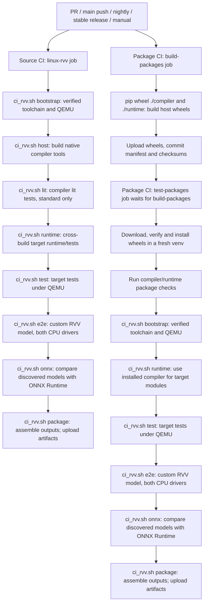
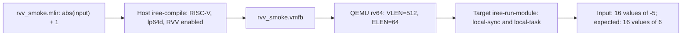

# Linux host CI for RISC-V Linux with RVV

Two standalone GitHub Actions workflows build IREE on an Ubuntu 24.04 x86_64
host and test a riscv64 Linux target under QEMU:

| Workflow | Source of the host compiler used for RISC-V execution |
| --- | --- |
| Source CI - RISC-V Linux RVV (`ci_riscv64_linux_rvv.yml`) | Native CMake build tree from this commit |
| Package CI - RISC-V Linux RVV (`pkgci_riscv64_linux_rvv.yml`) | Compiler wheel built from this commit, uploaded, and installed in a separate job |

Both run on pull requests to `main`, pushes to `main`, manual dispatch, nightly
schedules, and stable GitHub release publication. Prerelease publication skips
the jobs. ONNX models are selected by the event's `pr`, `nightly` or `release`
suite; manual dispatch also permits an explicit `all` override.
They are independent workflows: package CI does not wait for source CI.
Within package CI, `test-packages` waits for `build-packages`. Neither requires
organization-specific runners, Azure caches, deployment secrets, or artifacts
from a different workflow run. Upstream `ci.yml` and `pkgci.yml` are unchanged;
their existing triggers still run independently and may add substantial work.

Both flows build from source. The distinction is which outputs are consumed:
source CI tests build-tree tools; package CI first makes installable compiler
and runtime wheels and tests their installed interfaces. The wheels are Linux
x86_64 host wheels, not RISC-V runtime wheels. The RISC-V runtime is separately
cross-built in both flows.

The new package workflow uses Ubuntu-native wheel builds, not upstream's
manylinux/auditwheel release packaging. These artifacts are intended for the
Ubuntu CI host and compatible environments; they are not certified portable
release wheels and are not uploaded to PyPI. Wheel artifacts are uploaded before
downstream testing, so require a successful `test-packages` job before using them.

## Workflow diagrams

These diagrams describe the configured pipeline. They do not establish that a
complete cross-target run has passed; see [Validation status](#validation-status).
Both branches start independently for the same event. Within each branch, later
build/test steps normally run only after preceding steps succeed. Diagnostic
uploads use `always()` so available logs can still be collected after failures.



The source diagram's `lit` node is skipped in `smoke`; the remaining stages
continue. Package CI never invokes `host` or `lit`: it obtains host tools from
its newly built wheels, rather than building another native CMake tree in the
test job.

The custom model's correctness check is:



## Files and commands used at each step

The workflow entry points are [source CI][source-workflow] and
[package CI][package-workflow]. Both call the shared [ci_rvv.sh helper][ci-helper].
Stage names below are its command-line arguments, for example
`bash build_tools/riscv/ci_rvv.sh runtime`.

| Step | File or entry point | What actually runs / produces |
| --- | --- | --- |
| Triggers, profile, runner and dependencies | Both workflow YAML files | Select `standard` or `smoke`, check out submodules, install host prerequisites, set concurrency and timeouts |
| Cross-tool bootstrap | `ci_rvv.sh bootstrap` → `bootstrap()` | `curl`, `sha256sum`, and `tar`; downloads/extracts the checksum-pinned toolchain and QEMU |
| Native source build, source CI only | `ci_rvv.sh host` → `host()` | CMake/Ninja build of `iree-compile` and `iree-flatcc-cli`; standard also builds default targets and `iree-test-deps` |
| Compiler lit, source standard only | `ci_rvv.sh lit` → `lit()`; [iree_lit_test.cmake][lit-registration] | CTest selects `test-type=lit-test` under `host/compiler`; registered commands invoke LLVM lit, which executes the test files' `RUN:` lines and tools such as FileCheck |
| Host wheel build, package CI only | Inline shell in `pkgci_riscv64_linux_rvv.yml`; [compiler/setup.py][compiler-setup] and [runtime/setup.py][runtime-setup] | `python -m pip wheel --no-deps --no-build-isolation --wheel-dir wheelhouse ./compiler`, then `./runtime`; setuptools/CMake build the native packages |
| Artifact handoff, package CI only | Inline shell and upload/download actions in package workflow | Upload/download `riscv-ci-host-wheels`; verify `SHA256SUMS` and `commit.txt`; pip-install the local wheels in a fresh venv; set `IREE_HOST_BIN_DIR` to its `bin/` |
| Installed package checks | [compiler _package_test.py][compiler-package-test] and [runtime _package_test.py][runtime-package-test] | `python -m iree.compiler._package_test`, `python -m iree.runtime._package_test`, and `iree-compile --version` |
| Target cross-build | `ci_rvv.sh runtime` → `runtime()`; [linux_riscv64.cmake][riscv-toolchain] | CMake/Ninja cross-build using the RISC-V toolchain; host tools come from the source build or the installed wheels |
| Runtime/CTS execution | `ci_rvv.sh test` → `test_runtime()`; [iree_cc_test.cmake][runtime-registration] and [run_riscv_test.sh][riscv-runner] | CTest executes registered target tests through the QEMU wrapper; smoke selects 11 tests, standard selects supported runtime tests including registered CPU HAL CTS |
| Core e2e execution, standard only | `ci_rvv.sh test` → `test_runtime()` | A separate CTest invocation in `target/tests/e2e` runs generated target programs with the configured RISC-V exclusions |
| Custom RVV e2e | `ci_rvv.sh e2e` → `e2e()`; [rvv_smoke.mlir][smoke-model] | Host `iree-compile` creates a VMFB; explicit QEMU invocations run target `iree-run-module` with both CPU drivers and `--expected_output=16xf32=6` |
| Discovered ONNX models | `ci_rvv.sh onnx` → `onnx_tests()`; `build_tools/riscv/onnx_compare.py` | Generate/load shared inputs; run ONNX Runtime on host; import/compile for RVV; execute under QEMU and compare every output on both drivers |
| Assemble target artifacts | `ci_rvv.sh package` → `package()` | Copies runtime, model and reports; writes source commit, target/profile description and checksums; does not build wheels or publish a release |
| Upload outputs and diagnostics | Both workflow YAML files | Upload target artifacts after successful checks; attempt diagnostic upload even when earlier steps fail |

The wheel build uses each package's `pyproject.toml`/`setup.py` build backend.
The commands are inline in the package workflow; there is no separate wheel
build shell script in this new flow.

The new helper runs CMake and CTest directly. It does **not** call upstream's
`build_all.sh`, `ctest_all.sh`, `build_riscv.sh`, `test_riscv.sh`,
`riscv_bootstrap.sh`, or `build_linux_packages.sh`. It reuses the existing
RISC-V CMake toolchain and test registration/wrapper machinery, and currently
mirrors the exclusions in `test_riscv.sh` and download hashes in
`riscv_bootstrap.sh`. Keep these mirrored settings aligned when updating them.

[source-workflow]: ../../../../../.github/workflows/ci_riscv64_linux_rvv.yml
[package-workflow]: ../../../../../.github/workflows/pkgci_riscv64_linux_rvv.yml
[ci-helper]: ../../../../../build_tools/riscv/ci_rvv.sh
[lit-registration]: ../../../../../build_tools/cmake/iree_lit_test.cmake
[compiler-setup]: ../../../../../compiler/setup.py
[runtime-setup]: ../../../../../runtime/setup.py
[compiler-package-test]: ../../../../../compiler/bindings/python/iree/compiler/_package_test.py
[runtime-package-test]: ../../../../../runtime/bindings/python/iree/runtime/_package_test.py
[riscv-toolchain]: ../../../../../build_tools/cmake/linux_riscv64.cmake
[runtime-registration]: ../../../../../build_tools/cmake/iree_cc_test.cmake
[riscv-runner]: ../../../../../build_tools/cmake/run_riscv_test.sh
[smoke-model]: ../../../../../build_tools/riscv/rvv_smoke.mlir

## Adjustable coverage

PR and push runs use `standard`. Manual runs expose a `profile` choice:

| Profile | Source flow | Package flow |
| --- | --- | --- |
| `smoke` | Build host tools; run 11 target runtime tests and custom RVV model | Validate installed wheels; run the same target smoke coverage |
| `standard` | Build host tests and run configured compiler lit tests; run supported target runtime/CTS, core e2e, and custom RVV model | Validate installed wheels; run supported target runtime/CTS, core e2e, and custom RVV model |

For both package profiles, build both host wheels, validate installed package
APIs, and run the selected target coverage using the installed compiler. Package
CI does not run compiler lit tests; source CI supplies that coverage. `standard`
uses the RISC-V exclusions from `test_riscv.sh`; it does not promise every source
test or every driver runs. Counts depend on configuration. Each suite fails on
an empty CTest selection and writes a separate XML report. Smoke additionally
requires exactly 11 executed, passing CTest entries.

Both workflows cap build parallelism at two jobs and allow 180 minutes per job.
Change `CMAKE_BUILD_PARALLEL_LEVEL` and timeouts in the workflow if your runner
capacity differs. For local script runs set `IREE_RISCV_TEST_PROFILE=standard`
or `smoke`; the script itself defaults to `smoke` for backwards compatibility.

The exact coverage split is:

| Check | Source smoke | Source standard | Package smoke | Package standard |
| --- | --- | --- | --- | --- |
| Build native compiler from this commit | Build-tree tools | Build-tree tools | Compiler wheel | Compiler wheel |
| Installed compiler/runtime package checks | No | No | Yes | Yes |
| Configured compiler lit tests on host | No | Yes | No | No |
| 11 selected target runtime tests | Yes | Part of broader suite | Yes | Part of broader suite |
| Broader supported target runtime tests | No | Yes | No | Yes |
| Registered local-sync/local-task HAL CTS | No | Yes | No | Yes |
| Supported core e2e suite | No | Yes | No | Yes |
| Custom RVV model on both CPU drivers | Yes | Yes | Yes | Yes |
| Discovered ONNX models versus ONNX Runtime | Yes | Yes | Yes | Yes |
| Physical RISC-V board tests | No | No | No | No |

Compiler lit checks transformations and expected IR on the host. Runtime tests
check target runtime behavior; CTS checks device API conformance; core e2e
compiles and executes programs and checks results. Package checks validate the
installed host interfaces. Custom RVV e2e checks the model above with RVV
enabled, but is not exhaustive vector instruction or microkernel coverage.

See [ONNX reference comparison on RISC-V](onnx-model-tests.md) for static model
folders with `input.py`, data and external weights, PR/nightly/release selection,
input NPZ data, tolerances, and report locations. Dynamic shapes are an explicit
legacy opt-in rather than the default case format.

## What is built and tested

There are two distinct toolchains. The native Clang compiler builds
`iree-compile` for the Linux host. That executable translates MLIR into an
IREE VMFB containing RISC-V machine code. A cross-compilation Clang toolchain
builds `iree-run-module` and runtime unit tests for the RISC-V Linux target.
The host compiler and runtime come from the same repository commit.

The target uses the `lp64d` ABI and RVV 1.0. The model compilation enables
`m,a,f,d,c,v,zvl512b`; QEMU uses VLEN=512 and ELEN=64. The runtime itself uses
the repository's existing scalar RV64GC configuration, while the model can
use vector instructions. This is one supported test profile, not a promise
that the artifacts run on every RISC-V board. In particular, a smaller VLEN
or missing extension requires a matching compiler and emulator profile.

That 512-bit profile applies to the existing core/custom smoke tests. Discovered
ONNX tests now default to 1024 bits and support per-model and command-line
overrides that change compiler features and QEMU together. They also delegate
preparation to standalone scripts; see the [ONNX guide](onnx-model-tests.md).

| Stage | Required evidence |
| --- | --- |
| Bootstrap | SHA-256 verification of both toolchain and QEMU downloads |
| Host build | `iree-compile` and `iree-flatcc-cli` built from this commit |
| Target build | RISC-V runtime, 11 selected test executables, and topology data built successfully |
| Runtime tests | Smoke: 11 entries; standard: supported runtime tests, including registered CPU HAL CTS |
| Compiler lit | Source standard: registered host compiler lit tests; absent from package CI |
| Core e2e | Standard: host-compiled RISC-V modules executed under QEMU, with current RISC-V exclusions |
| Model test | Compile `rvv_smoke.mlir` for the LLVM CPU backend with RVV enabled; execute on both `local-sync` and `local-task` |
| Correctness | All 16 output values equal 6 for input values of -5 |
| Delivery | Upload the tested runtime, model, JUnit results, source commit, target description, and checksums |

The smoke runtime tests cover bitmap/status/string utilities, task process/executor/
topology behavior, and VM buffer/list/ref/stack behavior. The topology test
also needs the `iree_runtime_task_expanded_sysfs_snapshots` build target.
The model smoke test is functional coverage with RVV enabled; it does not
prove every vector instruction or microkernel path is exercised. Expand it
with your actual models, shapes, data types, and numerical tolerances.

QEMU validates target instruction execution and functional integration.
It does not measure board performance or establish compatibility with a
particular board's Linux image, dynamic libraries, memory limits, or drivers.
The standard profile adds configured compiler lit coverage in source CI and
broader target coverage in both flows. Board benchmarks and additional RVV
profiles remain useful future additions.

## Enable it in your fork

1. Push the branch containing this workflow to your fork and open a pull request
   targeting `main`. The PR starts the checks. Alternatively, merge the workflow
   to the default branch to make it available through Actions →
   either **Source CI - RISC-V Linux RVV** or **Package CI - RISC-V Linux RVV**
   → **Run workflow**, and select the profile.
2. If Actions is disabled in the fork, enable it in the repository's Actions
   settings. No personal access token or deployment secret is needed.
3. After successful first runs, configure branch protection/a ruleset for
   `main` and require the source `linux-rvv` check and package `test-packages`
   check. Select the exact check names shown by GitHub after they actually run.
4. Download the `riscv64-linux-rvv-<commit>` artifact from the successful run.
   Diagnostic reports are retained for failed runs when available.

The workflows use read-only repository permissions, avoid persisted Git
credentials, and cancels obsolete runs on the same ref. LLVM builds are large:
the initial workflow allows 180 minutes and limits compilation to two jobs
and linking to one job to fit standard hosted-runner memory. Actual duration
depends on runner capacity and the commit. It does not cache executable build
outputs across pull requests. Public/private repository Actions quotas and
artifact storage limits still apply. Running both flows on every PR duplicates
compiler builds intentionally: one validates source tests, the other packaging.
To reduce cost, remove the package workflow's `pull_request` trigger and retain
its push/manual triggers. Required branch checks must match that trigger policy.

## Run the same stages on your Linux host

Install Git, Python 3 with venv support, Clang, LLD, Ninja, curl, and CA
certificates. CMake must be at least 3.26; CI pins 3.31.6. On Ubuntu 24.04:

```sh
sudo apt-get update
sudo apt-get install -y git python3-venv clang lld ninja-build curl ca-certificates
python3 -m venv ../iree-ci-tools
../iree-ci-tools/bin/python -m pip install cmake==3.31.6 packaging \
  -r runtime/bindings/python/iree/runtime/build_requirements.txt \
  -r build_tools/riscv/onnx_requirements.txt
export PATH="$(realpath ../iree-ci-tools/bin):$PATH"
git submodule update --init --depth 1 --jobs 4
export CMAKE_BUILD_PARALLEL_LEVEL=2
export IREE_RISCV_TEST_PROFILE=standard
bash build_tools/riscv/ci_rvv.sh all
```

Run these commands from the repository root. Outputs go to the ignored
`build-riscv-ci/` directory. Set `IREE_RISCV_CI_DIR` to an absolute path for a
different output location. Use the existing checkout in an isolated cloud
task; a separate Git worktree is unnecessary.

Individual stages are `bootstrap`, `host`, `lit`, `runtime`, `test`, `e2e`, `onnx`, and
`package`. Standard runs them in that order; smoke omits `lit`. `all` handles
this automatically. `package`
alone only copies existing results, so use `all` for validated delivery.
After editing runtime code, rerun `runtime`, `test`, and `e2e`. After editing
compiler code, also rerun `host`. Keep host and target outputs on the same
source revision.

Downloads require HTTPS access to GitHub (submodules), PyPI (CMake), and
`sharkpublic.blob.core.windows.net` (the repository's prebuilt tools), plus
your distribution's package mirrors. SHA-256 pins match those in
`build_tools/riscv/riscv_bootstrap.sh`; verification stays enabled on every run.
An invalid cached archive causes a failure: remove that archive and retry
the bootstrap rather than changing the expected hash.

## Delivery versus deployment

This workflow implements continuous integration and delivers validated build
artifacts. It does not automatically install anything on a RISC-V board or
publish a GitHub release. The runtime executable is dynamically linked;
the board needs compatible Linux userspace libraries, including the dynamic
loader and C/C++ runtime. The downloaded cross sysroot is for QEMU testing,
not a board root filesystem image.

Before adding deployment, establish the board model, CPU extensions and VLEN,
Linux image/sysroot, transfer mechanism, installation directory, and rollback
procedure. Add a separate hardware test/deployment job gated on CI success.
For remote boards, use a protected GitHub environment and securely stored
deployment credentials; do not expose a self-hosted board runner or credentials
to untrusted pull request code. Start with manual deployment approval and keep
the previous working artifacts for rollback. Test your real models on hardware
before adding release automation or performance gates.

## Validation status

Actionlint, ShellCheck, shell syntax, and the native smoke test-stage checks
have been exercised during implementation. Complete source/standard, wheel
build/install, and cross-target QEMU runs still need successful GitHub Actions
runs. The cloud environment previously denied the prebuilt tool download host;
do not interpret workflow configuration or successful linting as target readiness.

The discovered ONNX runner was additionally validated under actual RISC-V QEMU
using an alternative signed Debian toolchain and a released host compiler; see
[its validation details](onnx-model-tests.md#implementation-validation). This
does not establish that the complete workflows or original download path passed.
